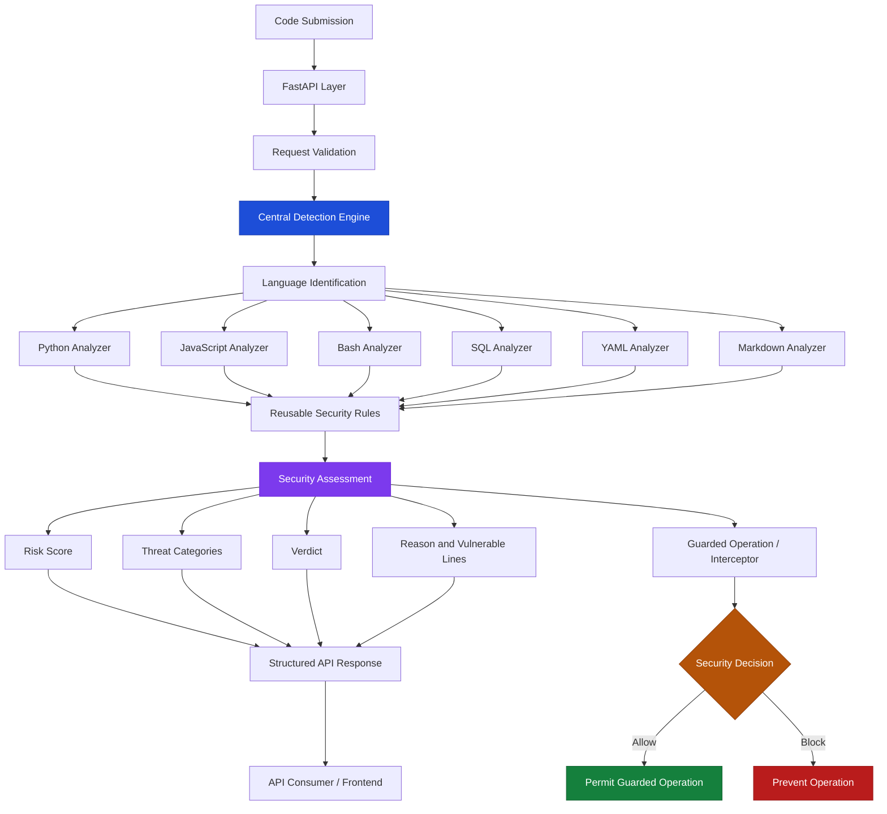

# 🛡️ CodeGuard

### Pre-execution Security Analysis for AI-Generated Code

**Detect threats before code reaches execution.**

CodeGuard is a lightweight, multi-language static security analysis layer designed to identify potentially dangerous code before execution. It analyzes code for security risks, assigns a risk score, identifies suspicious lines, and returns an `ALLOW` or `BLOCK` verdict.

Built for a world where AI coding assistants generate code faster than developers can manually review it, CodeGuard aims to make security checks a practical part of the code execution workflow.

---

## 🚨 The Problem

AI coding assistants can generate code that contains security vulnerabilities or potentially dangerous operations, including:

* Hardcoded credentials and exposed secrets
* Data exfiltration and suspicious network activity
* Destructive shell commands
* Obfuscated or dynamically executed payloads
* Persistence and privilege-escalation patterns
* Risky dependencies
* Resource-exhaustion patterns
* Server-side request forgery (SSRF)
* Instructions targeting AI systems

Traditional workflows often discover these issues during code review, testing, or after execution has begun.

**CodeGuard introduces a security checkpoint before execution.**

## 💡 The Solution

CodeGuard accepts a code snippet, analyzes it using static security rules, and produces a structured security report.

### How it works

```text
        Code Submission
               |
               v
      CodeGuard Interface
       Web UI / REST API
               |
               v
       Language Detection
               |
               v
    Language-Specific Analysis
               |
               v
      Security Rule Engine
               |
               v
       Finding Normalization
               |
               v
        Risk Evaluation
               |
          +----+----+
          |         |
          v         v
        ALLOW     BLOCK
          |         |
          v         v
      Return a    Prevent the
       verdict    gated action
```

**Important:** CodeGuard analyzes submitted code as text. It does not execute the submitted source during static analysis. The execution-gate demonstration uses a harmless predefined callback rather than running user-submitted code.

An `ALLOW` verdict means the configured rules did not identify sufficient risk to block the submission. It is not a guarantee that the code is safe.

---

## ✨ Features

* **Multi-language analysis:** Supports Python, JavaScript, Bash, SQL, YAML, and Markdown.
* **Nine threat categories:** Covers common suspicious patterns across code and configuration files.
* **Risk scoring:** Produces a normalized risk score between `0` and `1`.
* **Actionable findings:** Reports detected categories, explanations, and vulnerable line numbers.
* **Execution-gate demonstration:** Illustrates how a blocking verdict can prevent a predefined action from being invoked.
* **REST API:** Integrates with other applications through FastAPI.
* **Interactive API documentation:** Explore endpoints through Swagger UI.
* **Lightweight analysis:** Designed for CPU-only execution.
* **No external LLM dependency for verdicts:** Runtime security decisions use the implemented static-analysis logic rather than external LLM API calls.
* **Automated tests:** Includes backend and frontend tests for regression checking.

## 🔍 Threat Categories

| Category                   | Purpose                                                                 |
| -------------------------- | ----------------------------------------------------------------------- |
| `secret_access`            | Identifies potential secret exposure or risky secret-handling patterns. |
| `data_exfiltration`        | Detects suspicious attempts to transfer potentially sensitive data.     |
| `destructive_command`      | Identifies potentially destructive commands or operations.              |
| `persistence_or_privesc`   | Looks for persistence or privilege-escalation patterns.                 |
| `obfuscated_execution`     | Detects suspicious combinations of obfuscation and dynamic execution.   |
| `dependency_risk`          | Identifies configured dependency-risk patterns.                         |
| `resource_exhaustion`      | Looks for patterns that may exhaust system resources.                   |
| `ssrf_network_exfil`       | Detects configured SSRF and suspicious network-transfer patterns.       |
| `ai_targeted_instructions` | Identifies instructions targeting AI systems or their behavior.         |

Detection depends on the implemented rules. Static analysis cannot identify every vulnerability, and some findings may require human review.

## 🧱 Technology Stack

| Component           | Technology                      |
| ------------------- | ------------------------------- |
| Frontend            | React                           |
| Frontend build tool | Vite                            |
| Code editor         | Monaco Editor, where configured |
| Backend             | Python                          |
| API framework       | FastAPI                         |
| API server          | Uvicorn                         |
| Testing             | Pytest and Vitest               |
| Analysis            | Static security rules           |

---

## System Architecture

CodeGuard is a static security analysis layer designed to evaluate potentially unsafe code before a guarded operation is allowed to proceed. It combines language-specific analyzers, reusable security detection rules, a centralized assessment pipeline, and a fail-closed interception workflow.

### Architecture Diagram



### Core Components

| Component                           | Responsibility                                                                                                                                                           |
| ----------------------------------- | ------------------------------------------------------------------------------------------------------------------------------------------------------------------------ |
| **FastAPI Layer**                   | Exposes HTTP endpoints for health checks, code evaluation, and interception demonstrations.                                                                              |
| **Request Validation**              | Validates incoming requests before passing code to the detection pipeline.                                                                                               |
| **Central Detection Engine**        | Coordinates language identification and the appropriate security analysis.                                                                                               |
| **Language-Specific Analyzers**     | Inspect code or configuration according to the supported language and analysis rules.                                                                                    |
| **Reusable Security Rules**         | Detect patterns associated with threats such as secret access, data exfiltration, destructive commands, resource exhaustion, dependency risks, and suspicious execution. |
| **Security Assessment**             | Produces the verdict, risk score, threat categories, explanation, and vulnerable-line information.                                                                       |
| **Guarded Operation / Interceptor** | Demonstrates how an assessment can control whether a guarded operation is permitted or blocked.                                                                          |
| **Frontend / API Consumer**         | Submits code and displays the resulting security assessment.                                                                                                             |

### Evaluation Workflow

1. **Code submission:** A client submits a code snippet through the API.
2. **Request validation:** The API validates the request format.
3. **Language identification:** The central detector determines which analysis path to use.
4. **Static analysis:** The applicable analyzer examines the submitted code using the implemented security rules.
5. **Risk assessment:** CodeGuard produces a structured assessment containing the verdict, risk score, threat categories, explanation, and relevant line numbers.
6. **Response generation:** The API returns the assessment, including evaluation latency.
7. **Interception:** In the guarded-operation workflow, the assessment is used to demonstrate an allow-or-block decision.

### Fail-Closed Security Design

CodeGuard includes a fail-closed interception workflow intended to avoid permitting guarded operations when a valid security decision cannot be obtained.

This is distinct from the `/evaluate` endpoint: returning a `block` verdict does not itself prevent an unrelated process from executing the submitted code. Enforcement depends on the guarded operation or integration that consumes the assessment.

### Design Principle

**Detect before execution. Assess the risk. Enforce the decision.**

CodeGuard is intended to provide an additional security layer for evaluating potentially unsafe code. It is not a replacement for operating-system isolation, sandboxing, least-privilege execution, or comprehensive application security controls.

---

## 🏗️ Project Structure

```text
CodeGuard/
├── app.py                    # FastAPI application
├── requirements.txt          # Python dependencies
├── pyproject.toml            # Python project configuration, if present
├── src/
│   └── detector.py           # Main detection interface
├── tests/                    # Backend tests
├── evaluation/               # Benchmark and evaluation utilities
├── demo/                     # Demonstration utilities
├── docs/                     # Project documentation
├── frontend/
│   ├── src/
│   │   ├── api/              # API client
│   │   ├── components/       # UI components
│   │   ├── hooks/            # React hooks
│   │   ├── data/             # Sample code and categories
│   │   └── App.jsx           # Main interface
│   ├── package.json
│   └── index.html
├── .gitignore
├── LICENSE
└── README.md
```

The exact contents of directories may evolve as the project develops.

---

## 🚀 Getting Started

### Prerequisites

Install the following:

* Python 3.12 or a compatible version supported by the project
* Node.js and npm
* Git

### 1. Clone the repository

```bash
git clone https://github.com/Wizard52007/CodeGuard.git
cd CodeGuard
```

### 2. Set up the Python environment

**Windows PowerShell**

```powershell
python -m venv .venv
.\.venv\Scripts\Activate.ps1
python -m pip install --upgrade pip
pip install -r requirements.txt
```

If PowerShell blocks virtual-environment activation, you can invoke the environment's Python executable directly:

```powershell
.\.venv\Scripts\python.exe -m pip install -r requirements.txt
```

### 3. Start the backend

From the repository root:

```powershell
uvicorn app:app --host 127.0.0.1 --port 8000
```

The API will be available at:

* API base: `http://127.0.0.1:8000`
* Interactive documentation: `http://127.0.0.1:8000/docs`
* Health check: `http://127.0.0.1:8000/health`

### 4. Start the frontend

Open another terminal:

```powershell
cd frontend
npm install
npm run dev
```

Open the local Vite URL displayed in the terminal, normally:

`http://localhost:5173`

The backend must be running for live security analysis to work.

---

## 🔌 API Reference

### Health Check

**Endpoint**

```http
GET /health
```

Example response:

```json
{
  "status": "ok"
}
```

### Analyze Code

**Endpoint**

```http
POST /evaluate
```

**Request body**

```json
{
  "code": "print('Hello, CodeGuard!')"
}
```

The API accepts a code string for static analysis. Language detection and any optional language parameter must follow the backend implementation.

**Example response shape**

```json
{
  "verdict": "allow",
  "risk_score": 0.0,
  "categories": [],
  "code_language": "python",
  "reason": "No configured security rule triggered.",
  "vulnerable_lines": []
}
```

The example illustrates the response structure; actual verdicts, explanations, and scores depend on the submitted code and the detector's rules.

### Execution-Gate Demonstration

**Endpoint**

```http
POST /demo/intercept
```

This endpoint is intended to demonstrate the gate behavior. Consult the interactive API documentation for its exact request and response schemas.

The demonstration must not execute submitted source code. A blocking verdict should prevent the harmless demonstration callback from being invoked.

---

## 🧪 Testing

### Backend tests

Run from the repository root:

```powershell
python -m pytest -q
```

### Frontend tests

Run from the `frontend` directory:

```powershell
npm test
```

### Frontend production build

```powershell
npm run build
```

Run the tests against your current checkout before relying on their results. Passing tests demonstrate behavior covered by those tests, not complete security coverage.

## 📊 Evaluation

CodeGuard includes evaluation utilities for measuring detection performance on labeled examples.

Useful metrics include:

* **Accuracy:** Fraction of all examples classified correctly.
* **Precision:** Fraction of blocked examples that are actually labeled as threats.
* **Recall:** Fraction of labeled threats successfully detected.
* **F1 score:** Harmonic mean of precision and recall.
* **False-positive rate:** Fraction of benign examples incorrectly blocked.
* **Latency:** Time required to analyze a submission.

To reproduce the public development benchmark, run:

```powershell
python evaluation/evaluate_official_dev.py
```

The benchmark result applies to the examples in that evaluation set. It should not be interpreted as a guarantee of performance on unseen code or hidden evaluations.

---

## ☁️ Deployment

CodeGuard can be deployed as separate frontend and backend services.

### Backend

A typical FastAPI web-service configuration uses:

**Build command**

```bash
pip install -r requirements.txt
```

**Start command**

```bash
uvicorn app:app --host 0.0.0.0 --port $PORT
```

### Frontend

For a Vite-based static site:

**Root directory**

```text
frontend
```

**Build command**

```bash
npm install && npm run build
```

**Publish directory**

```text
dist
```

Configure the frontend's API base URL to point to the deployed backend. If the frontend and backend use different origins, configure the backend's CORS policy to allow the frontend's origin.

Deployment settings may need adjustment depending on the hosting platform and repository configuration.

---

## 🔐 Security and Limitations

CodeGuard is a static-analysis layer, not a complete security sandbox.

* Submitted code must never be executed as part of static analysis.
* An `ALLOW` verdict does not prove that a submission is safe.
* Rule-based detection can miss novel, context-dependent, or obfuscated threats.
* Legitimate code may resemble suspicious behavior and produce false positives.
* Detection quality depends on the supported languages, rules, and evaluation data.
* The demonstration gate is not a substitute for operating-system isolation, sandboxing, permissions, or runtime monitoring.
* Production deployments should use appropriate request-size limits, timeouts, access controls, and logging practices.
* Never submit real passwords, API keys, or other sensitive credentials to a public demonstration.

## 🛣️ Future Improvements

Potential directions for future development include:

* Improved data-flow and context-aware analysis.
* More robust language detection.
* Better false-positive handling.
* Expanded adversarial test suites.
* Performance and large-input testing.
* Integration with developer tools and AI coding workflows.
* Additional security rules and language support.
* More detailed explanations and remediation suggestions.

## 🤝 Contributing

Contributions and feedback are welcome.

1. Fork the repository.
2. Create a feature branch.
3. Make a focused change.
4. Add or update relevant tests.
5. Run the test suite and frontend build.
6. Open a pull request describing the change.

## 📄 License

See the [`LICENSE`](LICENSE) file for the project's licensing terms.

## 👥 Team

**CodeGuard** — a security-focused project exploring how static analysis can help identify risky code before execution.

---

**CodeGuard: Analyze first. Execute only through a properly controlled workflow.**
